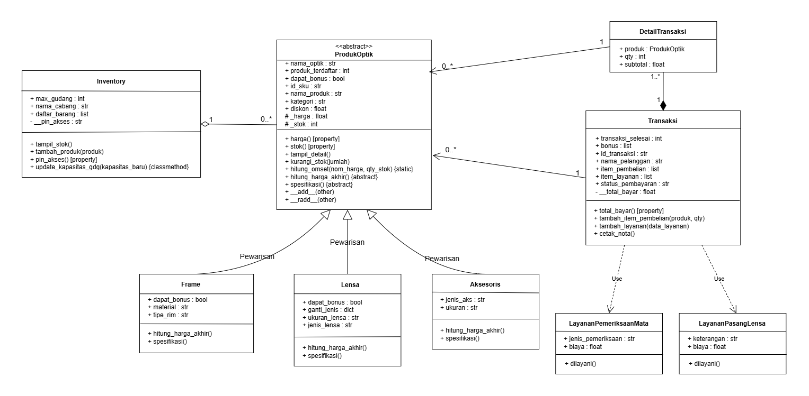

# POSTTEST 3 - Abstraksi, Polimorfisme & Prinsip SOLID

Program ini merupakan **Sistem Manajemen Optik Cahaya** berbasis Python dengan menerapkan konsep **Abstraksi (Abstract Base Class)**, **Polimorfisme (Method Overriding & Duck Typing)**, **Magic Methods**, serta **Prinsip SOLID** dalam Pemrograman Berorientasi Objek (PBO).

---

## 👤 Identitas Praktikan

* **Nama** : Nur Azizah Islamiyah
* **NIM** : 2509106018
* **Kelas** : A1 2025
* **Mata Kuliah** : Praktikum Pemrograman Berorientasi Objek
* **Tema** : Sistem Manajemen & Transaksi Optik Cahaya

---

## 🗂️ Struktur Program

```text
POSTTEST_PBO_3/
├── img/
│   ├── UML.png
│   ├── 1. INSTANSIASI OBJEK.png
│   ├── 2. METHOD, DUCK TYPING, MAGIC METHOD.png
│   ├── 3. ENKAPSULASI & TRY EXCEPT.png
│   ├── 4. TABEL STOK.png
│   └── 5. STRUK.png
├── posttest-3.py      
└── readme.md            
```

---

## 📐 Relasi UML (Unified Modeling Language)
<p align="center">
  
</p>

1. **Pewarisan (`ProdukOptik` `<|--` `Frame`, `Lensa`, `Aksesoris`)**: `ProdukOptik` sebagai kelas induk abstrak mewariskan atribut dasar dan enkapsulasi ke kelas turunan.
2. **Agregasi (`Inventory` `◇--` `ProdukOptik`)**: Kelas `Inventory` menampung banyak produk, di mana produk dapat berdiri sendiri meskipun inventaris cabang dihapus.
3. **Asosiasi (`Transaksi` & `DetailTransaksi` `--` `ProdukOptik`)**: Hubungan relasi struktural di mana objek `Transaksi` dan `DetailTransaksi` menggunakan atau merujuk ke objek `ProdukOptik` dalam proses pembelian barang.
4. **Komposisi (`Transaksi` `*--` `DetailTransaksi`)**: Objek `DetailTransaksi` dibentuk secara langsung di dalam kelas `Transaksi`, sehingga siklus hidupnya terikat penuh.
5. **Dependency / Use (`Transaksi` `..>` `LayananPemeriksaanMata` & `LayananPasangLensa`)**: `Transaksi` berkolaborasi dengan kelas layanan secara dinamis menggunakan *Duck Typing*.
---

## 🏛️ Struktur Class & Penerapan Pilar OOP

### 1. Class & Atribut/Method
* **`ProdukOptik` (Abstract Class)**: Atribut (`id_sku`, `nama_produk`, `kategori`, `_harga`, `_stok`, `diskon`). Method (`harga()`, `stok()`, `tampil_detail()`, `hitung_harga_akhir() {abstract}`, `spesifikasi() {abstract}`).
* **`Frame`, `Lensa`, `Aksesoris`**: Subclass turunan yang mengimplementasikan method abstrak secara polimorfis.
* **`Inventory`**: Mengelola daftar barang dan keamanan PIN (`__pin_akses`).
* **`Transaksi` & `DetailTransaksi`**: Menangani pengelolaan status pembayaran, total potongan, dan rincian item belanja.
* **`LayananPemeriksaanMata` & `LayananPasangLensa`**: Kelas layanan pendukung transaksi mandiri tanpa pewarisan.

### 2. Penerapan Pilar OOP Khusus Posttest 3
* **Abstraksi (Abstraction)**: Menggunakan `ABC` dan decorator `@abstractmethod` pada `ProdukOptik` untuk memaksa seluruh subclass (`Frame`, `Lensa`, `Aksesoris`) mendefinisikan ulang method `hitung_harga_akhir()` dan `spesifikasi()`.
* **Polimorfisme (Polymorphism)**:
  * *Method Overriding*: Kalkulasi harga akhir berbeda di setiap jenis produk (misalnya `Lensa` memperhitungkan tambahan biaya jenis lensa / *surcharge*).
  * *Duck Typing*: Fungsi `layanan_optik()` mengeksekusi method `dilayani()` dari objek berbeda tanpa memedulikan hierarki kelas.
  * *Operator Overloading*: Magic method `__add__` dan `__radd__` memungkinkan penjumlahan harga objek produk langsung menggunakan operator `+` atau fungsi `sum()`.
* **Enkapsulasi (Encapsulation)**: Proteksi data sensitif menggunakan modifier `_` (*protected*) dan `__` (*private*), diakses melalui `@property` dan `@setter` untuk validasi input (seperti mencegah stok/harga negatif).
* **Pewarisan (Inheritance)**:
  * Kelas `Frame`, `Lensa`, dan `Aksesoris` mewarisi seluruh atribut dan method dasar dari kelas induk `ProdukOptik` menggunakan sintaks `super().__init__()`.
  * Menghindari redundansi kode untuk atribut umum seperti `id_sku`, `nama_produk`, `_harga`, `_stok`, dan `diskon`.
---

## 🛠️ Penerapan Prinsip SOLID
### 1. Single Responsibility Principle (SRP)
> *"Sebuah kelas hanya memiliki satu alasan untuk berubah."*

* **`ProdukOptik` & Subclass (`Frame`, `Lensa`, `Aksesoris`)**:
  * **Fokus Utama**: Mengelola cetak biru (*blueprint*) data fisik produk, atribut harga, stok, serta kalkulasi harga akhir berbasis diskon.
  * **Alasan Berubah**: Hanya berubah jika terdapat penyesuaian atribut barang atau rumus kalkulasi harga produk.
* **`Inventory`**:
  * **Fokus Utama**: Mengelola pencatatan stok gudang cabang dan keamanan autentikasi PIN cabang.
  * **Alasan Berubah**: Hanya berubah jika aturan manajemen penyimpanan barang di gudang atau sistem keamanan PIN cabang mengalami perubahan.
* **`DetailTransaksi`**:
  * **Fokus Utama**: Mengisolasi rincian item produk yang dibeli (kuantitas dan perkalian subtotal item) sebagai bentuk *Komposisi*.
  * **Alasan Berubah**: Hanya berubah jika ada penyesuaian atribut rincian item belanja.
* **`Transaksi`**:
  * **Fokus Utama**: Menangani alur proses kasir, akumulasi pembayaran, rekap total potongan, serta pencetakan nota struk resmi.
  * **Alasan Berubah**: Hanya berubah jika terdapat perubahan aturan bisnis transaksi kasir (seperti format cetak nota atau penentuan shift kasir).


### 2. Open/Closed Principle (OCP)
> *"Entitas perangkat lunak (kelas, modul, fungsi) harus terbuka untuk ekstensi (dapat diperluas), tetapi tertutup untuk modifikasi."*

```python
class ProdukOptik(ABC):
    @abstractmethod
    def hitung_harga_akhir(self):
        pass

class Lensa(ProdukOptik):
    def hitung_harga_akhir(self):
        ganti = self.ganti_jenis.get(self.jenis_lensa, 0)
        harga_dasar_lensa = self._harga + ganti
        return harga_dasar_lensa * (1 - self.diskon)
```

* **Terbuka untuk Ekstensi**: Jika di masa depan sistem ingin ditambahkan kategori barang baru (misalnya kelas `Softlens` atau `KacamataHitam`), developer hanya perlu membuat *subclass* baru yang mewarisi `ProdukOptik` dan mendefinisikan aturan harga akhirnya sendiri.
* **Tertutup untuk Modifikasi**: Penambahan kategori produk baru tersebut dapat dilakukan **tanpa perlu mengubah sedikit pun kode yang sudah ada** di kelas induk `ProdukOptik`, kelas `Inventory` (method `tampil_stok()`), maupun kelas `Transaksi`.


### 3. Liskov Substitution Principle (LSP)
> *"Objek dari kelas turunan harus dapat menggantikan posisi objek dari kelas induknya tanpa merusak fungsionalitas program."*

```python
class Inventory:
    def tampil_stok(self):
        # ...
        for produk in self.daftar_barang:
            produk.tampil_detail()  
```

* Di dalam list `self.daftar_barang`, objek yang disimpan adalah gabungan dari instansiasi *subclass* `Frame`, `Lensa`, dan `Aksesoris`.
* Ketika method `tampil_stok()` dijalankan, setiap objek *subclass* dipanggil melalui method `produk.tampil_detail()` yang secara internal mengeksekusi `hitung_harga_akhir()` dan `spesifikasi()`.
* Seluruh *subclass* dapat menggantikan posisi tipe `ProdukOptik` secara mulus tanpa memicu *error*, tanpa memecahkan tipe data, dan tanpa memerlukan pengkondisian manual (`if-else` tipe kelas) saat pencetakan tabel stok inventaris berlangsung.

---


## 💻 Panduan Program & Hasil Output

Berikut adalah penjelasan tahapan eksekusi program yang dibagi menjadi 5 bagian beserta tangkapan layar (*screenshot*) outputnya:

### 1. Instansiasi Produk, Inventory, dan Transaksi
Pada bagian awal program, objek-objek produk diinisialisasi dengan parameter diskon, dimasukkan ke dalam inventaris cabang menggunakan method `tambah_produk()`, serta mempersiapkan objek transaksi (`transaksi1` & `transaksi2`).
<p align="center">
  
</p>

### 2. Pemanggilan Method, Duck Typing, & Magic Method
Menampilkan hasil perhitungan omset via `@staticmethod`, pembaruan kapasitas gudang via `@classmethod`, eksekusi layanan mandiri via *Duck Typing*, dan uji penjumlahan paket produk via *Magic Method* (`__add__`).
<p align="center">
  
</p>

### 3. Validasi Enkapsulasi & Exception Handling (Try-Except)
Menguji pengaman setter terhadap nilai negatif pada stok dan harga produk, validasi format PIN inventory, serta pembuktian penanganan *Error* saat mencoba menginstansiasi kelas abstrak `ProdukOptik` secara langsung menggunakan blok *try-except*.
<p align="center">
  
</p>

### 4. Tampilan Tabel Stok Inventaris Cabang
Menampilkan daftar tabel seluruh barang di inventaris secara rapi. Pemanggilan method `tampil_detail()` di dalamnya secara otomatis memicu polimorfisme untuk mencetak spesifikasi dan harga akhir tiap-tiap produk.
<p align="center">
  
</p>

### 5. Struk Nota Belanja Kasir Transparan
Mencetak nota pembelian resmi yang memuat rincian harga asli (kotor), rekap total potongan diskon secara transparan, bonus item gratis, serta deteksi otomatis shift kasir berdasarkan waktu sistem komputer.
<p align="center">
  
</p>

---
